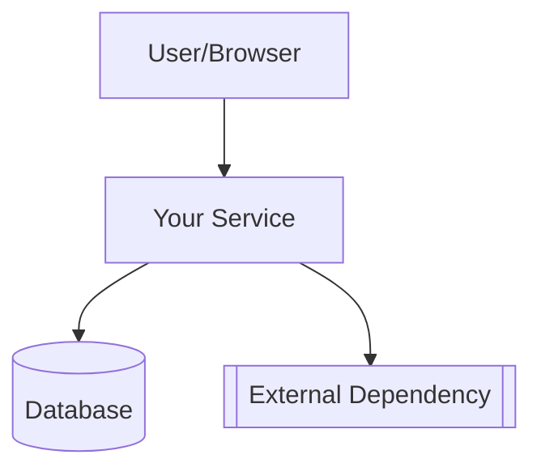
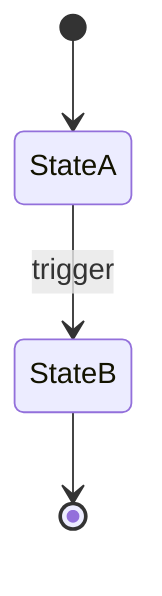
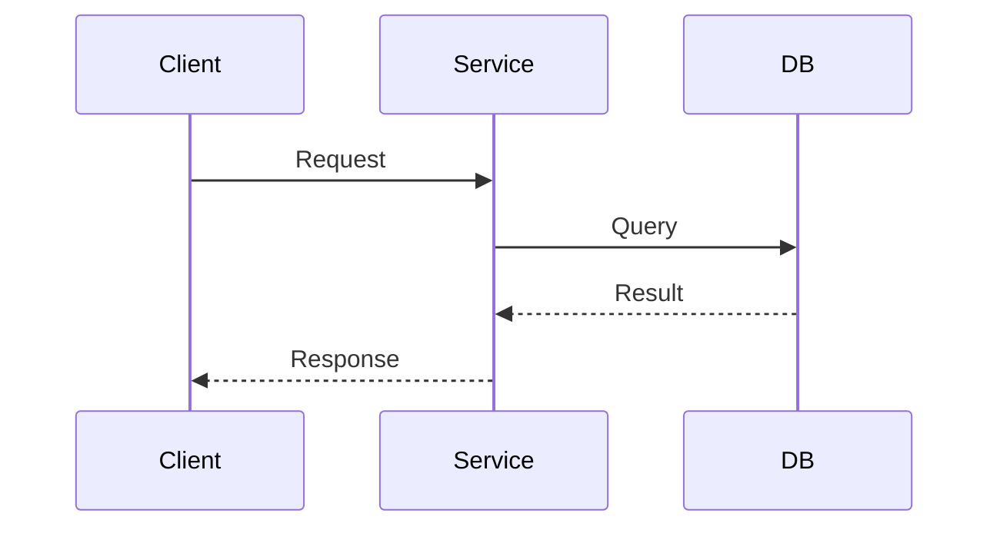
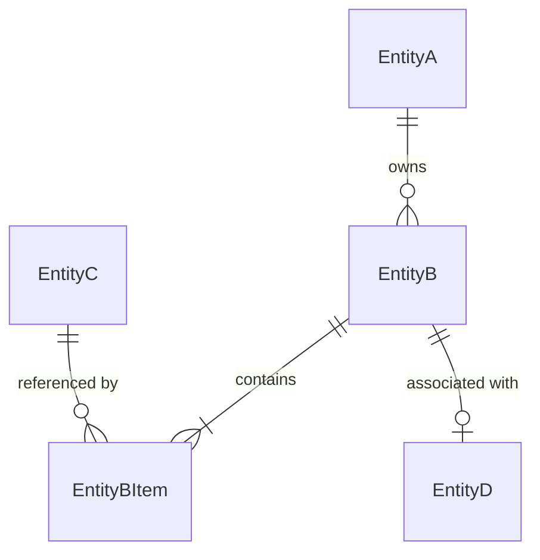
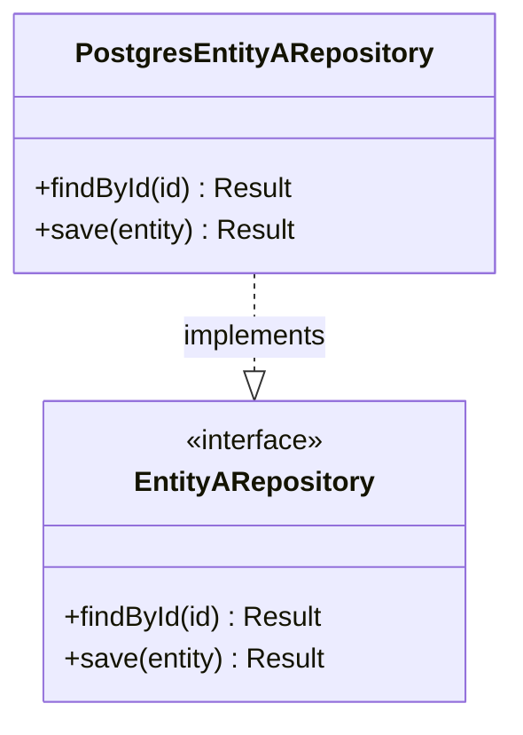

# Technical Design Document (TDD) Skill

## When to Use

Activate when the user asks you to:
- "Create a TDD" or "write a TDD"
- "Create a technical design document" or "technical document"
- "Write a design doc" or "design document"
- "Document the architecture" or "create architecture documentation" — **but only for pre-implementation planning.** If the user wants to document an already-built system, suggest a README or ADR instead (see "When NOT to Use").
- Any similar request for technical planning documentation

**Trigger note:** The user said "TDD" — assess context. If they're clearly talking about **Test-Driven Development** (writing tests first), do NOT activate this skill. If ambiguous, ask: "Do you want a Technical Design Document, or are you referring to Test-Driven Development?"

## When NOT to Use

Do NOT activate this skill for:
- **Trivial changes** — a one-line bugfix, typo fix, config tweak, or dependency bump
- **Exploratory/prototyping phase** — requirements are still unknown or rapidly changing. If the user insists on a TDD despite this, suggest a lightweight "design memo" instead and explain why a full TDD may not be useful yet.
- **Post-hoc documentation** — the system is already built and the user just wants to document it after the fact (use a README or ADR instead). Exception: documenting an existing system before a major refactor or redesign IS a valid TDD use case.
- **Test-Driven Development requests** — the user wants to write tests first, not a design document
- **User explicitly asks for something else** — e.g., "just write the code"

If the request falls into one of these categories, politely explain why a TDD is not the right artifact and suggest an alternative.

## Tiering Guide — Choose the Right Level

Do NOT produce the same 15-page document for every request. Select a tier based on project scope.

### Tier Definitions

| Tier | When to Use | Target Length |
|------|-------------|---------------|
| **Full TDD** | New system, greenfield project, major feature, cross-team impact, high-risk change | 5–15 pages |
| **Mini TDD** | Well-understood feature, single team, moderate complexity, backwards-compatible change | 2–4 pages |
| **Rapid TDD** | Small config change, simple API endpoint, straightforward internal refactor | 1–2 pages |

> **"Cross-team impact" heuristic:** If another team must read this TDD to do their work (consume an API, adapt to a schema change, onboard to the system), it likely warrants a Full TDD.

**How to decide:** If unsure, default to Mini TDD. Only use Full TDD for genuinely complex, high-risk, or cross-team work. If the user pushes back, they'll tell you.

### Section Inclusion by Tier

Every section must be explicitly assigned. Use this table to determine what to include:

| Section | Full TDD | Mini TDD | Rapid TDD |
|---------|----------|----------|-----------|
| 1. TL;DR | ✅ Include | ✅ Include | ✅ Include (1–2 sentences) |
| 2. Context & Scope | ✅ Include | ✅ Include | ✅ Include (brief) |
| 3. Goals & Non-Goals | ✅ Include | ✅ Include | ✅ Include (1–2 goals) |
| 4. Proposed Solution | ✅ All subsections | ✅ 4 intro paragraph + 4.3 (brief) + 4.5 + 4.7.1 + 4.7.2 (simplified) | ✅ 4 intro paragraph only — no subsections |
| 4.1 Architecture Diagram | ✅ Include | ❌ Omit | ❌ Omit |
| 4.2 Component & Module Design | ✅ Include | ❌ Omit — see 4.7 for data/class definitions | ❌ Omit |
| 4.3 API / Interface Design | ✅ Include | ✅ Include (brief description, skip full table if simple) | ❌ Omit |
| 4.4 Key Flows | ✅ Include | ❌ Omit | ❌ Omit |
| 4.5 Technology Stack | ✅ Include | ✅ Include | ❌ Omit |
| 4.6 Migration Strategy | ✅ If applicable | ❌ Omit | ❌ Omit |
| 4.7 Implementation Blueprint | ✅ All subsections | ✅ 4.7.1 + 4.7.2 only (simplified — key types, skip class diagrams if trivial) | ❌ Omit |
| 5. Assumptions & Dependencies | ✅ Include | ✅ Include | ❌ Omit |
| 6. Alternatives Considered | ✅ Include | ✅ Include (1–2 alternatives) | ❌ Omit |
| 7. Cross-Cutting Concerns | ✅ Include applicable subsections | ✅ Include applicable subsections only | ❌ Omit |
| 8. Testing Strategy | ✅ Include | ✅ 8.2 Key Scenarios only (skip 8.1 Testing Levels) | ❌ Omit |
| 9. Deployment & Rollout Plan | ✅ Include | ❌ Omit | ❌ Omit |
| 10. Open Questions | ✅ Include | ✅ Include | ✅ Include |
| 11. Risks & Mitigations | ✅ Include | ❌ Omit | ❌ Omit |
| 12. Timeline & Milestones | ✅ If applicable | ❌ Omit | ❌ Omit |
| 13. Document History | ✅ Include | ✅ Include | ✅ Include |

**How to skip sections:** For omitted sections, add a single-line note: `> **Omitted** per Mini TDD guidelines.` (or Rapid TDD). Do NOT include the section heading. For sections that are "if applicable," omit entirely if they don't apply — no skip note needed.

**Section numbering:** Always keep the original template section numbers, even when sections are omitted. This preserves cross-references and makes it easy to add sections back later.

---

## What Goes Where — Section Boundaries

Sections 4.2, 4.3, and 4.7 cover related but distinct concerns. Use this rubric to decide where content belongs:

| Concern | Section | What to Document |
|---------|---------|-----------------|
| **Conceptual decomposition** — what modules exist, what they're responsible for, how they interact | 4.2 Component & Module Design | Module responsibilities, key exports, dependencies between modules, events, state management, error handling strategies |
| **External contracts** — what the system exposes to or consumes from the outside | 4.3 API / Interface Design | HTTP endpoints, request/response schemas, gRPC services, external integrations, schema evolution |
| **Code-level scaffolding** — concrete type definitions, class signatures, function contracts | 4.7 Implementation Blueprint | Entity type definitions, database schemas, interface contracts, class hierarchies, function signatures, enums, error types |

**Key principle:** 4.2 answers "what does each part do?" 4.3 answers "what does the system expose?" 4.7 answers "what code will a developer write?"

**Avoiding duplication:** If a Full TDD includes all three sections:
- 4.2 describes module responsibilities at a conceptual level (e.g., "OrderService manages order lifecycle")
- 4.3 documents the HTTP endpoints (e.g., `POST /orders`)
- 4.7 defines the actual types and interfaces (e.g., `interface OrderService { createOrder(...) }`)
- Do NOT repeat the same information in multiple sections. Cross-reference when needed: "See 4.7.2 for the OrderService interface definition."

**For Mini TDDs** (which omit 4.2): The 4.7.1/4.7.2 data and class definitions serve as both the conceptual and concrete specification. The one-paragraph summary in section 4 provides the architectural context that 4.1–4.6 would normally cover.

---

## Discovery Protocol — Gather Before You Write

Before writing anything, you must gather enough context to produce accurate content. Do NOT fabricate details.

### Minimum Required Inputs
If the user hasn't provided these, **ask before writing — via the interview tool** (see "Discovery Interview" below):

1. **System/feature name** — what is this TDD about?
2. **Problem statement** — what problem are we solving?
3. **Scope** — what's in scope? What's out of scope?

### Discovery Interview — ask via the interview tool

Do NOT ask discovery questions as a series of chat messages, and do NOT skip them. When required inputs are missing, run **one `interview` form** — load the `interview` skill for the exact questions JSON schema and authoring rules. Structure it as:

- An `info` panel with the tier table (Full / Mini / Rapid) so the user can choose with context
- A `single` tier question with a `recommended` option and your reasoning in `context`
- Questions covering the required inputs the user hasn't already given: system/feature name, problem statement, scope (in/out), consumers/dependents, and whether an existing system is being replaced
- For **Full or Mini tier** (which include section 4.7): the blueprint questions — primary language, ORM/migration tool, existing type conventions, polyglot components. Derive `recommended` options from your codebase research rather than asking blind

**Skip the discovery interview entirely when the user's request already answers the required inputs** (name, problem, scope) — go straight to research. If only 1–2 inputs are missing, still use the form; one focused form beats a chat back-and-forth.

**Do NOT ask blueprint questions if the TDD will be Rapid tier** (which omits section 4.7 entirely).

### Research to Perform
If the codebase exists and is accessible:
- Read existing **README**, **ADRs** (in `docs/adr/` or similar), and relevant source files
- Check `package.json`, `go.mod`, `Cargo.toml`, `requirements.txt`, or equivalent for tech stack
- Look at `git log --oneline -20` for recent activity and context
- Check for existing docs in `docs/`, `design/`, or `docs/tdd/` directories
- **For the Implementation Blueprint (section 4.7):** Identify the project's primary language and type system. Read existing model/entity definitions, repository interfaces, and service classes to match the codebase's conventions. If the codebase uses an ORM, read existing model definitions to match the pattern. If it uses a specific API framework (Express, FastAPI, etc.), read existing route/controller definitions to match the style. **Validate that new blueprint types are consistent with existing types** (e.g., don't introduce `id: string` if the codebase uses `id: number` or a branded `UserId` type).

**For greenfield projects with no existing codebase:**
- Ask the user directly about language, framework, and database choices
- Skip codebase research steps — they don't apply
- Collect unknowns for the pre-finalize interview (see below) instead of marking them inline — a greenfield TDD will naturally have more of these
- The TDD will naturally have more `[Needs input: ...]` markers — this is expected and acceptable

Do NOT fabricate project structure, team names, deadlines, or cost estimates. If you can't find the information, mark it with **"[Needs input: description of what's needed]"** — not a fabricated value.

**Important:** Do NOT use `[Needs input: ...]` inside code blocks or Mermaid diagrams — it will break syntax. Inside code blocks, use the target language's comment syntax instead (e.g., `// NEEDS_INPUT: confirm field type` for TypeScript, `# NEEDS_INPUT: confirm field type` for Python, `// NEEDS_INPUT: confirm field type` for Go). Inside Mermaid diagrams, use a descriptive placeholder label instead.

### Pre-Finalize Interview — resolve unknowns before you finish

After drafting, sweep the document for anything you would have marked `[Needs input: ...]` or parked in section 10 (Open Questions). **Before finalizing, ask those questions via a second `interview` form** — one question per unknown, with the surrounding draft context in each question's `context` field so the user can answer without hunting through the doc.

Then:

- **Fold the answers in.** Replace the corresponding `[Needs input: ...]` markers and resolve the Open Questions rows the user answered. The document must not ship with questions in it that the user just answered.
- **Only what the user explicitly defers** ("later", "don't know", "skip") stays in section 10 (Open Questions) with a resolution plan. The Open Questions table is for genuinely deferred unknowns — not a parking lot for things you never asked.
- `[Needs input: ...]` markers are a **last resort** — only for unknowns that could not be asked in a form (e.g., only a third party holds the answer). Everything askable gets asked.

---

## Output Location

Create the TDD inside a **`docs/tdd/`** directory relative to the current working directory. The file must be a `.md` file named after the system it documents.

1. **Create** the `docs/tdd/` directory if it doesn't exist.
2. **Name the file** after the system/feature the TDD is being written for:
   - **If documenting a system:** `docs/tdd/<system-name>.md` — e.g., `docs/tdd/billing-service.md`
   - **If documenting a feature:** `docs/tdd/<system-name>-<feature>.md` — e.g., `docs/tdd/billing-service-invoice-generation.md`
   - **If the system has a codename:** use that — e.g., `docs/tdd/project-nightingale.md`

If the user doesn't specify what the system is called, ask for the name before writing.

**File conflict handling:**
- If `docs/tdd/<name>.md` already exists, check if the user wants to:
  - **Overwrite** (if updating an existing TDD)
  - **Create a new version** (append `-v2`, `-v3`, etc.)
  - **Edit the existing file** (read it, apply targeted edits to relevant sections, keep unchanged content)
- Default: ask the user what they want to do. Never silently overwrite without asking.

**Write the content to disk after generating it.** The agent must explicitly write the file — describing the content is not enough.

**Updating an existing TDD:**
- If the user says "update the TDD for system X," read the existing file first
- Add a new entry to the Document History section
- Modify relevant sections, keeping the original content that hasn't changed
- Do NOT rewrite the entire document from scratch unless the changes are foundational

**For feedback/review scenarios:**
- If the user says "address review comments" or "the design changed mid-implementation," treat it as an update to the existing TDD
- Update the relevant sections, add a Document History entry, and update the status field if appropriate

---

## Depth & Proportionality Guidance

**Output only what is useful.** Every section must contain meaningful content specific to the project. However:

- **Genuinely inapplicable sections** — omit them per the tiering table above. No skip note needed for "if applicable" sections that don't apply.
- **Unknown information** — use **"[Needs input: describe what's missing]"** rather than fabricating. This is preferred over confident hallucination.
- **Exact versions, costs, and deadlines** — only include if the user provided them or you found them in the codebase. Do not invent.
- **Bracketed text in the template** — items like `[system-name]` or `[what it does]` are template variables you must replace with project-specific content. If information is truly unknown, write **`[Needs input: describe what's missing]`** instead of fabricating.

The finished TDD should serve as a complete reference. If a reader needs information to implement correctly, include it. If they can infer it from context, skip it.

**Blueprint code is illustrative, not authoritative.** The Implementation Blueprint (4.7) uses code-like syntax for clarity, but it is not compiled, linted, or CI-gated. Developers must validate blueprint types against a real compiler before using them. Include a note to this effect in the TDD if the blueprint is substantial.

---

## Template

> ⚠️ **The template below contains illustrative examples (diagrams, code, tables) to show format. You must replace every example with project-specific content.** Do not copy the example text, diagram labels, class names, or table values verbatim — they are placeholders for you to overwrite.

> ⚠️ Bracketed items like `[system-name]` or `[what it does]` are template variables — replace them with actual content. If you don't know, use `[Needs input: ...]`.

> ⚠️ **Tier markers** like `> **Full TDD only**` are instructions for you (the agent), not content to include in the output. Follow them but do not copy them into the generated TDD.

Consider adding a **Markdown table of contents** at the top of the document for Full TDDs (8+ sections). Mini and Rapid TDDs typically don't need one.

---

# Technical Design Document: [System/Feature Name]

> **Status:** Draft / In Review / Approved / Superseded *(pick one)*
> **Author(s):** [Name] *(skip if unknown)*
> **Reviewer(s):** [Name] *(skip if unknown)*
> **Last Updated:** [Current date]
> **Related docs:** [Link to PRD, issue tracker tickets, existing ADRs, or other docs. Use real links if known, otherwise skip.]

---

## 1. TL;DR

A concise executive summary (3–5 sentences normally, 1–2 for a Rapid TDD). Cover: what we're building, why, the key architectural decision, and the expected outcome. Someone who reads only this section should understand the essence of the project.

---

## 2. Context & Scope

### 2.1 Current State
Describe the existing system, its architecture, what works and what doesn't. Include concrete pain points, incidents, or limitations that motivate this work. Reference data (latency, error rates, usage numbers) where available. If no existing system exists, state that clearly.

### 2.2 Problem Statement
What specific problem are we solving? One clear paragraph. This should be understandable by someone unfamiliar with the project.

> **Mini/Rapid TDD:** If the problem is well-understood and documented in a PRD, keep this brief and link to the PRD.

---

## 3. Goals & Non-Goals

### Goals
Specific, measurable outcomes. Each goal should be testable/verifiable.

**Bad:** "Make the system faster."
**Good:** "Reduce p99 latency on the search endpoint from 800ms to under 250ms."

**Bad:** "Improve reliability."
**Good:** "Achieve 99.95% uptime (≤4.38h downtime/year) for the new service."

List the goals that actually apply — do not pad. For a Rapid TDD, 1–2 goals is fine.

### Non-Goals
Things that would be reasonable goals but are explicitly **out of scope** for this project. This prevents scope creep and forestalls reviewer questions.

Examples:
- "Real-time streaming is a non-goal — batch processing every 5 minutes is sufficient."
- "Multi-region deployment is a non-goal — we will start with single-region and add multi-region in a follow-up."
- "ACID compliance across services is a non-goal — we accept eventual consistency for this use case."

List non-goals only if there are boundaries worth calling out. 0–3 is fine. Do not invent non-goals just to fill space.

---

## 4. Proposed Solution

> **This section is the heart of the TDD.** Lead with a one-paragraph summary that stands alone — anyone too busy to read the full doc should skim this paragraph and the Alternatives Considered section and understand the full approach.

**Start with a one-paragraph summary here, before any subsections.** Write it in bold or as its own block. It must cover:
- What the solution is
- The key architectural choice
- Why it's the right approach

Then expand with the subsections relevant to your project per the tiering table. Not all subsections apply to every project — use your judgment.

### 4.1 Architecture Diagram

> **Full TDD only.**

> ⚠️ Mermaid diagrams render on GitHub but may not render in all markdown viewers (VS Code preview, Confluence, Notion, some wikis). Consider adding a brief text description alongside the diagram if you know the document will be viewed in one of these environments.

Describe and illustrate the system architecture. Use Mermaid diagrams where they save words (for cross-service flows). Skip diagrams when prose is faster.

Create a **system context diagram** showing how this system fits into the broader ecosystem (external systems, users, dependencies). If the system has multiple services, also add a **container/component diagram** showing the internal services and their relationships.

> ⚠️ **Replace this example** with your project's actual components, names, and connections:



Describe each component's responsibility:

| Component | Responsibility |
|-----------|---------------|
| [component name] | [what it does] |
| [component name] | [what it does] |

### 4.2 Component & Module Design

> **Full TDD only.**

> ⚠️ **Replace this example** with your project's actual language, framework, and module structure:

```
src/
├── module-name/
│   ├── feature-a/
│   └── feature-b/
├── shared/
│   ├── utilities/
│   └── types/
└── main.ts
```

**4.2.1 Key Modules / Components**

| Module | Responsibility | Key Exports | Dependencies |
|--------|---------------|-------------|-------------|
| [module] | [what it does] | [public API surface] | [other modules or external systems] |
| [module] | [what it does] | [public API surface] | [other modules or external systems] |

> **Note:** This table describes modules at a conceptual level (what they do, what they export). For concrete interface definitions, see section 4.7.2. Do not duplicate type signatures here — describe responsibilities and public API surface in prose.

**4.2.2 Events & Messages (if event-driven)**

If the system produces or consumes events, catalog them:

| Event | Producer | Consumers | Payload (key fields) | Trigger |
|-------|----------|-----------|---------------------|---------|
| [event name] | [who emits] | [who consumes] | `{ field1, field2 }` | [what triggers it] |

For each event, consider whether to document: schema, delivery guarantees (at-least-once, etc.), dead-letter policy, and retry strategy — only if these are specified or can be inferred from context. If unknown, skip or mark as "[To be determined during implementation]."

**4.2.3 State Management (if stateful)**

| Component | State Held | Lifetime | Persistence |
|-----------|-----------|----------|-------------|
| [component] | [what state] | [how long it lives] | [where it's stored] |

If the system has notable state transitions, describe them:



> **Note:** For code-level enum definitions and transition tables, see section 4.7.5. This section describes state conceptually; 4.7.5 defines the concrete types.

**4.2.4 Error Handling**

Document how the system handles errors. This should be at an appropriate level of detail — not every error type needs a separate circuit breaker. Focus on meaningful failure modes.

| Error Scenario | Handling Strategy | User-facing Impact |
|---------------|-------------------|-------------------|
| [what goes wrong] | [retry, circuit break, fail-fast, fallback] | [what the user sees] |

> **Boundary note:** This section covers error handling at the **component level** (what each component does when things go wrong). System-wide reliability patterns (SLOs, graceful degradation of dependencies) belong in the Cross-Cutting Concerns section (7.2) instead. For code-level error/exception type definitions, see section 4.7.6. **Heuristic:** if the pattern applies to the entire system, it's 7.2; if it applies to a specific component, it's 4.2.4; if it's a type definition, it's 4.7.6.

---

### 4.3 API / Interface Design

> **Full TDD + Mini TDD.** For Mini TDDs, a brief description of the interface may suffice instead of a full table.

Document the interfaces this system exposes or consumes. For HTTP APIs:

| Method | Path | Purpose | Request | Response |
|--------|------|---------|---------|----------|
| POST | /api/v1/[resource] | [what it does] | `{ [fields] }` | `{ [fields] }` |

**Internal interfaces:** Events (if not already in 4.2.2), gRPC services, shared library contracts. If 4.2 is omitted (Mini TDD), document events here instead.

**External integrations:** Third-party APIs, auth with external systems, data format and protocol details.

**Schema evolution:** If this is a long-lived interface, note how changes will be versioned (URL versioning, header versioning, additive-only changes, etc.).

> **Note:** This section documents the external contract (endpoints, request/response shapes). For code-level type definitions of request/response DTOs, see section 4.7.1.

---

### 4.4 Key Flows (Sequence Diagrams)

> **Full TDD only.**

> ⚠️ Mermaid diagrams render on GitHub but may not render in all markdown viewers. Consider adding a brief text description alongside the diagram if you know the document will be viewed in one of these environments.

Walk through the main workflows. Use Mermaid sequence diagrams for critical paths — skip for straightforward flows where prose is clearer.

> ⚠️ **Replace this example** with your project's actual participants and steps:



Cover the critical paths that are non-obvious:
- **Happy path** — the primary success flow (required)
- **Error paths** — only if they involve non-trivial recovery logic
- **Edge cases** — only if they change the flow substantially

Do NOT diagram every endpoint. Select 1–3 flows that best illustrate the design.

---

### 4.5 Technology Stack

> **Full TDD + Mini TDD.**

| Layer | Technology | Version | Rationale |
|-------|-----------|---------|-----------|
| Language | [language] | [version] | [why chosen — if known] |
| Framework | [framework] | [version] | [why chosen — if known] |
| Database | [database] | [version] | [why chosen — if known] |
| Infrastructure | [platform] | — | [why chosen — if known] |

Only include a rationale if you actually know it. If the choice was "it's what the team already uses," say that. If unknown, omit the rationale column.

**Do not fabricate version numbers.** If the version is undetermined, say "Latest stable as of [date]" or "TBD."

---

### 4.6 Migration Strategy (if applicable)

> **Full TDD only.** Only include if this work replaces or modifies an existing system with data or traffic to migrate.

1. **Schema migrations** — how data moves from old to new structure
2. **Data backfill** — how historical data is handled (if needed)
3. **Cutover strategy** — blue/green, feature flags, dark launches
4. **Rollback plan** — how to undo if something goes wrong
5. **Validation** — how we verify the migrated data is correct

For each, describe at a level appropriate to the risk. A simple column rename needs less detail than a full database migration.

---

### 4.7 Implementation Blueprint

> **Full TDD (all subsections) / Mini TDD (4.7.1 + 4.7.2 only, simplified).** Rapid TDDs omit this section entirely.

This section is the **code-level scaffolding** — a concrete specification of what will be built, expressed in the project's actual language and types. It bridges the gap between "what the architecture looks like" (4.1–4.6) and "what code a developer writes on day one." A reader should be able to start implementing directly from this section.

**Language convention:** Use the project's actual language for all type definitions (TypeScript interfaces, Python dataclasses, Go structs, Rust structs, Java records, etc.). **If the language is unknown, use language-agnostic pseudocode** — describe fields and types in prose (e.g., "EntityA has fields: id (string, UUID), name (string, required), status (enum, see 4.7.5)") rather than forcing a specific syntax. Do NOT default to TypeScript for non-TypeScript projects.

**Architecture style convention:** The subsections below use OOP/layered examples (Repository, Service, interface) because that pattern is most common. Adapt the structure to match the project's architecture:
- **Functional programming** (Haskell, Clojure, Elixir): Replace "class/interface definitions" with module type signatures and function contracts. Replace "Repository pattern" with data access functions. Skip class hierarchy diagrams.
- **Actor/model** (Erlang, Akka): Document actor messages, supervision strategies, and mailbox contracts instead of class hierarchies.
- **Dataflow/pipeline** (Beam, Spark, Flink): Document pipeline stages, transform functions, and I/O connectors instead of service classes.
- **Entity-Component-System** (game dev): Document components, systems, and entity archetypes instead of class hierarchies.

**Polyglot projects:** If the system spans multiple languages, specify which language applies to each component in the Component Mapping table (4.7.4), and use the appropriate syntax for each.

> ⚠️ **Blueprint code is illustrative, not authoritative.** It has no compiler, linter, or CI gate. Developers must validate types against a real compiler before using them.

#### 4.7.1 Data Models & Schemas

Define the **core/domain entities** that are new or modified by this design. Do NOT attempt to define every entity in the system — focus on the entities this TDD introduces or changes. Use the project's actual type system — not prose descriptions.

**A. Entity / Type Definitions**

> ⚠️ **Replace these examples** with your project's actual types, fields, and language. The examples below show the same entity in multiple languages — use only the one that matches your project:

**TypeScript:**
```typescript
// Domain entities
interface EntityA {
  id: string;           // UUID v4
  name: string;         // required, max 255 chars
  status: EntityAStatus; // see 4.7.5
  createdAt: Date;
  updatedAt: Date;
}

interface EntityB {
  id: string;           // UUID v4
  entityAId: string;    // FK → EntityA.id
  value: number;        // stored in cents to avoid float issues
  items: EntityBItem[]; // embedded collection
}
```

**Python:**
```python
from dataclasses import dataclass, field
from datetime import datetime
from enum import Enum

class EntityAStatus(str, Enum):
    ACTIVE = "active"
    ARCHIVED = "archived"

@dataclass
class EntityA:
    id: str              # UUID v4
    name: str             # required, max 255 chars
    status: EntityAStatus # see 4.7.5
    created_at: datetime = field(default_factory=datetime.utcnow)
    updated_at: datetime = field(default_factory=datetime.utcnow)

@dataclass
class EntityBItem:
    ref_id: str          # FK → EntityC.id
    quantity: int
    unit_price_cents: int

@dataclass
class EntityB:
    id: str              # UUID v4
    entity_a_id: str     # FK → EntityA.id
    value: int           # stored in cents
    items: list[EntityBItem] = field(default_factory=list)
```

**Go:**
```go
type EntityAStatus string

const (
    EntityAStatusActive   EntityAStatus = "active"
    EntityAStatusArchived EntityAStatus = "archived"
)

type EntityA struct {
    ID        string         // UUID v4
    Name      string         // required, max 255 chars
    Status    EntityAStatus  // see 4.7.5
    CreatedAt time.Time
    UpdatedAt time.Time
}

type EntityBItem struct {
    RefID          string  // FK → EntityC.ID
    Quantity       int
    UnitPriceCents int
}

type EntityB struct {
    ID        string
    EntityAID string       // FK → EntityA.ID
    Value     int          // stored in cents
    Items     []EntityBItem
}
```

**B. Database Schema**

Choose the format that matches the project's data layer:

**Option 1: SQL DDL (if using raw SQL or migration files)**

> ⚠️ The example below uses PostgreSQL syntax. Adapt for your database (MySQL, SQLite, SQL Server, etc.). Key differences: UUID type, timestamp types, index syntax, and default value functions vary by database.

```sql
-- PostgreSQL example
CREATE TABLE entity_a (
    id         UUID PRIMARY KEY DEFAULT gen_random_uuid(),
    name       VARCHAR(255) NOT NULL,
    status     VARCHAR(32)  NOT NULL DEFAULT 'active',
    created_at TIMESTAMPTZ NOT NULL DEFAULT NOW(),
    updated_at TIMESTAMPTZ NOT NULL DEFAULT NOW()
);

CREATE TABLE entity_b (
    id         UUID PRIMARY KEY DEFAULT gen_random_uuid(),
    entity_a_id UUID NOT NULL REFERENCES entity_a(id) ON DELETE CASCADE,
    value      BIGINT NOT NULL CHECK (value >= 0),  -- BIGINT to avoid overflow
    created_at TIMESTAMPTZ NOT NULL DEFAULT NOW(),
    updated_at TIMESTAMPTZ NOT NULL DEFAULT NOW()
);

CREATE INDEX idx_entity_b_entity_a_id ON entity_b(entity_a_id);
```

**Option 2: ORM Model Definitions (if using an ORM)**

> ⚠️ **Replace with your project's ORM syntax.** Examples for common ORMs:

**Prisma (TypeScript):**
```prisma
model EntityA {
  id        String   @id @default(uuid())
  name      String
  status    String   @default("active")
  createdAt DateTime @default(now())
  updatedAt DateTime @updatedAt
  entityBs  EntityB[]
}

model EntityB {
  id        String   @id @default(uuid())
  entityAId String
  entityA   EntityA @relation(fields: [entityAId], references: [id], onDelete: Cascade)
  value     Int
  createdAt DateTime @default(now())
  updatedAt DateTime @updatedAt

  @@index([entityAId])
}
```

**SQLAlchemy (Python):**
```python
from sqlalchemy import Column, String, Integer, BigInteger, ForeignKey, DateTime
from sqlalchemy.orm import relationship
from sqlalchemy_utils import UUIDType
import uuid
from datetime import datetime

class EntityA(Base):
    __tablename__ = "entity_a"
    id = Column(UUIDType, primary_key=True, default=uuid.uuid4)
    name = Column(String(255), nullable=False)
    status = Column(String(32), nullable=False, default="active")
    created_at = Column(DateTime, nullable=False, default=datetime.utcnow)
    updated_at = Column(DateTime, nullable=False, default=datetime.utcnow, onupdate=datetime.utcnow)
    entity_bs = relationship("EntityB", back_populates="entity_a", cascade="all, delete-orphan")

class EntityB(Base):
    __tablename__ = "entity_b"
    id = Column(UUIDType, primary_key=True, default=uuid.uuid4)
    entity_a_id = Column(UUIDType, ForeignKey("entity_a.id", ondelete="CASCADE"), nullable=False)
    value = Column(BigInteger, nullable=False)
    created_at = Column(DateTime, nullable=False, default=datetime.utcnow)
    updated_at = Column(DateTime, nullable=False, default=datetime.utcnow, onupdate=datetime.utcnow)
    entity_a = relationship("EntityA", back_populates="entity_bs")
```

**Option 3: NoSQL / Document Store (if using MongoDB, DynamoDB, etc.)**

> ⚠️ **Replace with your project's document schema.** Example for MongoDB:

```javascript
// MongoDB collection schemas
// Collection: entity_a
{
  _id: ObjectId,
  name: String,          // required, max 255 chars
  status: String,        // "active" | "archived"
  createdAt: Date,
  updatedAt: Date
}

// Collection: entity_b
{
  _id: ObjectId,
  entityAId: ObjectId,    // reference to entity_a
  value: Number,          // stored in cents (use Number for 32-bit, Long for 64-bit)
  items: [                // embedded documents
    { refId: ObjectId, quantity: Number, unitPriceCents: Number }
  ],
  createdAt: Date,
  updatedAt: Date
}
```

**C. Entity Relationships**

Use a Mermaid ER diagram when there are 3+ entities with non-trivial relationships. Skip for simple 1–2 table designs.

> ⚠️ Mermaid diagrams may not render in all markdown viewers. Consider adding a brief text description alongside the diagram.

> ⚠️ **Replace this example** with your project's actual entities and relationships:



For each relationship, note: cardinality (1:1, 1:N, M:N), cascade behavior (on delete/update), and whether it's enforced at the DB level or application level.

**D. Embedded vs. Separate Table Guidance**

When deciding whether a sub-entity (like `EntityBItem`) should be embedded in the parent document/record or stored in its own table, consider:
- **Embed** when: the sub-entity has no independent identity, is always accessed with the parent, and the collection is bounded (e.g., <100 items)
- **Separate table** when: the sub-entity has its own identity, is queried independently, or the collection is unbounded

Document the decision and rationale for non-obvious cases.

#### 4.7.2 Class & Interface Definitions

Define the key classes, interfaces, and their public API surface. Focus on **contracts** (what they expose), not implementations (how they work internally).

**A. Interface Contracts**

> ⚠️ **Replace these examples** with your project's actual interfaces. Use the project's language. The examples below show the same interface in multiple languages — use only the one that matches your project:

**TypeScript:**
```typescript
// Data access contracts
interface EntityARepository {
  findById(id: string): Promise<EntityA | null>;
  findWithPagination(opts?: PaginationOpts): Promise<PaginatedResult<EntityA>>;
  save(entity: EntityA): Promise<EntityA>;
  updateStatus(id: string, status: EntityAStatus): Promise<void>;
}

// Business logic contracts
interface EntityAService {
  createEntityA(name: string, opts?: CreateOpts): Promise<EntityA>;
  archiveEntityA(id: string): Promise<void>;
  getEntityA(id: string): Promise<EntityA>;
}
```

**Python:**
```python
from abc import ABC, abstractmethod

class EntityARepository(ABC):
    @abstractmethod
    async def find_by_id(self, id: str) -> EntityA | None: ...
    @abstractmethod
    async def save(self, entity: EntityA) -> EntityA: ...
    @abstractmethod
    async def update_status(self, id: str, status: EntityAStatus) -> None: ...

class EntityAService(ABC):
    @abstractmethod
    async def create_entity_a(self, name: str, opts: CreateOpts | None = None) -> EntityA: ...
    @abstractmethod
    async def archive_entity_a(self, id: str) -> None: ...
    @abstractmethod
    async def get_entity_a(self, id: str) -> EntityA: ...
```

**Go:**
```go
type EntityARepository interface {
    FindByID(ctx context.Context, id string) (*EntityA, error)
    Save(ctx context.Context, entity *EntityA) (*EntityA, error)
    UpdateStatus(ctx context.Context, id string, status EntityAStatus) error
}

type EntityAService interface {
    CreateEntityA(ctx context.Context, name string, opts *CreateOpts) (*EntityA, error)
    ArchiveEntityA(ctx context.Context, id string) error
    GetEntityA(ctx context.Context, id string) (*EntityA, error)
}
```

**B. Class Hierarchy**

Use a Mermaid class diagram when there are inheritance, composition, or implementation relationships worth showing. Skip for flat structures.

> ⚠️ Mermaid diagrams may not render in all markdown viewers. Consider adding a brief text description alongside the diagram.

> ⚠️ **Replace this example** with your project's actual classes. Only show alternative implementations (e.g., Postgres + InMemory) if they are part of the design (e.g., for testing, multiple storage backends) — not as a default illustration of the pattern.



**C. Design Patterns Used**

If the design relies on specific patterns, name them and show where they apply:

| Pattern | Where Applied | Purpose |
|---------|--------------|---------|
| Repository | `EntityARepository` interface | Decouple data access from business logic; enable test doubles |
| Strategy | `PricingStrategy` | Swap pricing algorithms without changing callers |

Only list patterns that meaningfully shape the code — don't pad with trivial ones. If no patterns are used, omit this subsection.

#### 4.7.3 Function Signatures

Document the key function/method signatures — the ones that define the system's core behavior. **Skip trivial CRUD wrappers** (e.g., simple `findById`, `save`, `delete` methods that are already defined in the interface contracts in 4.7.2). Focus on functions with non-obvious logic, multi-step workflows, or complex parameter types.

> ⚠️ **Replace these examples** with your project's actual functions. Use the project's language and comment syntax:

```typescript
// Core business logic with non-trivial behavior
function processEntityA(id: string, opts: ProcessingOpts): Promise<ProcessingResult>;
// Pseudocode:
// 1. Load EntityA and validate current state
// 2. Apply business rules based on opts.mode
// 3. Update status and persist
// 4. Publish domain event for downstream consumers

// Algorithm with complexity worth documenting
function findNearestRef(location: GeoPoint, radiusKm: number): Promise<Ref[]>;
// Pseudocode:
// 1. Query available refs within radius of location
// 2. Score each ref by: distance, rating, availability
// 3. Return top-scoring refs sorted by score
```

**When to include pseudocode:**
- The function implements a non-trivial algorithm (matching, scoring, scheduling, optimization, or any other complex business logic where the implementation is non-obvious from the signature alone)
- The function has side effects that aren't obvious from the signature alone
- The function has important edge cases or failure modes

**When to skip pseudocode:**
- Simple CRUD operations (create, read, update, delete)
- Straightforward data transformations
- Functions whose behavior is fully described by their type signature

#### 4.7.4 Component Mapping

A single table that ties together the system's components, their data models, their API endpoints, and their key classes/functions. This is the "glue" that shows how everything connects.

> ⚠️ **Replace this example** with your project's actual components. For components without API endpoints (e.g., internal event consumers), use "—". For polyglot projects, add a "Language" column.

| Component | Responsibility | Data Model(s) | API Endpoint(s) | Key Class(es) / Function(s) |
|-----------|---------------|---------------|------------------|------------------------------|
| EntityA Service | Manage EntityA lifecycle | `EntityA` | `POST /entity-a`, `GET /entity-a/{id}` | `EntityAService.createEntityA()`, `EntityAService.archiveEntityA()` |
| Processing Engine | Apply business rules and process | `ProcessingResult` | `POST /entity-a/{id}/process` | `processEntityA()` |
| Notification | Send status updates | `NotificationEvent` | — | `NotificationHandler.handle()` |

**How to use this table:** A developer implementing "EntityA Service" can read one row and know: what data they own, what endpoints they serve, and what classes/functions they need to write. This is the implementation starting point.

> ⚠️ **Maintenance warning:** This table aggregates information from sections 4.2, 4.3, 4.7.1, and 4.7.3. When any of those sections change during review, this table must also be updated. If it becomes stale, it will mislead implementers. Consider this table a summary, not a primary source — always verify against the detailed sections.

#### 4.7.5 Enums, Constants & Configuration

Define the enumerations, status codes, configuration values, and constants that shape the system's behavior. These are often the source of bugs when underspecified.

> ⚠️ **Replace these examples** with your project's actual enums and constants. Use the project's language and idiomatic patterns:

**TypeScript (use `as const` objects or union types instead of `enum`):**
```typescript
// Status values — document every valid state and transition
const EntityAStatus = {
  Active: "active",
  Archived: "archived",
} as const;
type EntityAStatus = typeof EntityAStatus[keyof typeof EntityAStatus];

// Configuration constants — include rationale for each value
const MAX_ITEMS_PER_ENTITY = 100; // Prevents unbounded collection growth; matches UI pagination limit
const PROCESSING_TIMEOUT_MS = 30_000; // Must complete within 30s to meet SLA
const MAX_RETRIES = 3; // Beyond 3 retries, escalate to manual intervention
```

**Python:**
```python
from enum import Enum

class EntityAStatus(str, Enum):
    ACTIVE = "active"     # → Archived
    ARCHIVED = "archived" # terminal state

# Configuration constants — include rationale for each value
MAX_ITEMS_PER_ENTITY = 100  # Prevents unbounded collection growth; matches UI pagination limit
PROCESSING_TIMEOUT_MS = 30_000  # Must complete within 30s to meet SLA
MAX_RETRIES = 3  # Beyond 3 retries, escalate to manual intervention
```

**Go:**
```go
type EntityAStatus string

const (
    EntityAStatusActive   EntityAStatus = "active"   // → Archived
    EntityAStatusArchived EntityAStatus = "archived" // terminal state
)

// Configuration constants — include rationale for each value
const (
    MaxItemsPerEntity  = 100    // Prevents unbounded collection growth; matches UI pagination limit
    ProcessingTimeoutMs = 30000 // Must complete within 30s to meet SLA
    MaxRetries         = 3      // Beyond 3 retries, escalate to manual intervention
)
```

**State transitions:** If the enum represents a state machine, document valid transitions. Use a transition table (preferred for clarity) or a Mermaid state diagram:

| From | To | Trigger |
|------|----|---------|
| Active | Archived | User archives the entity |
| Active | Active | Processing completes (no state change) |

> **Cross-reference:** If section 4.2.3 (State Management) is included (Full TDD), it describes state conceptually. This section defines the concrete enum values and transition rules. Keep them consistent — if both sections exist, 4.7.5 is the authoritative source for valid transitions.

#### 4.7.6 Error Types & Exception Contracts

> **Full TDD only.** For Mini TDDs, include error types inline in 4.7.2 interface definitions if they're critical to the contract.

Define how errors are represented in the system. This is essential for implementers — a developer cannot correctly implement a function without knowing whether to throw, return `null`, return a `Result<T,E>`, or use some other pattern.

**A. Error Representation Strategy**

State the project's error handling convention:

- **Exception-based** (throw/catch): Java, Python, C#
- **Result/Option types** (return `Result<T,E>` or `Option<T>`): Rust, Go (error return), TypeScript (if using `Result` pattern)
- **Error codes / status returns**: C, embedded systems
- **Union type discrimination**: TypeScript (if using discriminated unions)

**B. Error Type Definitions**

> ⚠️ **Replace these examples** with your project's actual error types:

**TypeScript (discriminated union):**
```typescript
type ServiceError =
  | { kind: "NotFound"; resource: string; id: string }
  | { kind: "ValidationError"; fields: Record<string, string> }
  | { kind: "Conflict"; message: string }
  | { kind: "RateLimited"; retryAfterMs: number };

// Usage in function signatures:
function getEntityA(id: string): Promise<Result<EntityA, ServiceError>>;
```

**Python (exception hierarchy):**
```python
class ServiceError(Exception):
    """Base error for the service."""

class NotFoundError(ServiceError):
    def __init__(self, resource: str, id: str):
        self.resource = resource
        self.id = id
        super().__init__(f"{resource} with id {id} not found")

class ValidationError(ServiceError):
    def __init__(self, fields: dict[str, str]):
        self.fields = fields
        super().__init__(f"Validation failed: {fields}")

class ConflictError(ServiceError):
    pass
```

**Go (error types):**
```go
type ServiceError struct {
    Kind    string // "NotFound", "ValidationError", "Conflict", "RateLimited"
    Message string
}

func (e *ServiceError) Error() string { return e.Message }

func NewNotFoundError(resource, id string) *ServiceError {
    return &ServiceError{Kind: "NotFound", Message: fmt.Sprintf("%s with id %s not found", resource, id)}
}
```

**C. API Error Response Contract**

If the system exposes HTTP APIs, define the error response format:

```typescript
// Standard error response shape
interface ErrorResponse {
  error: {
    kind: string;       // matches ServiceError.kind
    message: string;    // human-readable
    details?: unknown;  // optional machine-readable details
  };
}
```

| HTTP Status | Error Kind | When |
|-------------|-----------|------|
| 404 | NotFound | Resource does not exist |
| 400 | ValidationError | Request body fails validation |
| 409 | Conflict | Optimistic locking or uniqueness violation |
| 429 | RateLimited | Too many requests |

---

## 5. Assumptions & Dependencies

Document the assumptions this design relies on and the external dependencies it requires.

**Assumptions:**
- [Assumption 1 — e.g., "The payment gateway supports idempotent requests with an idempotency key."]
- [Assumption 2 — e.g., "The downstream service has a P99 latency under 500ms."]

**Dependencies:**
- [Dependency 1 — e.g., "Requires Redis 7+ for caching layer."]
- [Dependency 2 — e.g., "Depends on the Auth Service API for user authentication."]

---

## 6. Alternatives Considered

For each alternative (1–3 is enough — do not pad), provide:

**Alternative: [Name]**
- **What it is:** One or two sentences describing the approach.
- **Why it was plausible:** The genuine merits of this option.
- **Why it was rejected:** The specific trade-off or constraint that ruled it out.

> ⚠️ **Replace this example** with your project's actual alternatives:

> **Alternative: [Name]**
> *What it is:* [description]
> *Why plausible:* [merits]
> *Why rejected:* [specific reason — performance, cost, complexity, team expertise, etc.]

If the chosen approach was the only viable one, state: "No serious alternatives existed because [reason]." Do not fabricate alternatives.

---

## 7. Cross-Cutting Concerns

For each subsection below, include it **only if it applies to your project**. If a concern genuinely doesn't apply (e.g., no PII means no compliance burden), omit the subsection entirely — no skip note needed.

### 7.1 Security
Consider: authentication model, authorization, PII handling, encryption (at rest/in transit), secret management, audit logging, compliance requirements. **Only include what's relevant.**

### 7.2 Reliability & Availability
Consider: target SLO, redundancy, graceful degradation when dependencies fail, retry policies, circuit breakers, data durability. **Keep this at the system level** — component-level error handling belongs in 4.2.4, code-level error types in 4.7.6.

### 7.3 Performance & Scalability
Consider: expected load, latency targets, scaling strategy, caching, database query performance. Only include if performance is a concern for this project.

### 7.4 Observability
Consider: key metrics, logging approach, alerting rules, tracing strategy. Describe what's actually planned, not what would be nice to have.

### 7.5 Cost (if applicable)
Consider: infrastructure cost estimate, comparison with alternatives. **Only include if you have actual pricing data** — do not fabricate.

### 7.6 Compliance & Data Governance (if applicable)
Consider: data retention, deletion, residency, regulatory obligations. **Only include if the system handles regulated data.**

### 7.7 Environment & Configuration (if applicable)
Consider: dev/staging/prod environment differences, configuration management, feature flags, secrets per environment.

### 7.8 Accessibility & Internationalization (if applicable)
Consider: a11y standards (WCAG), i18n/l10n requirements, right-to-left support. **Only include for user-facing systems where these are requirements.**

---

## 8. Testing Strategy

Describe how the system will be tested. **Right-size this to the risk:** a simple API change may only need unit tests, while a critical financial system may need integration, contract, and load tests.

### 8.1 Testing Levels

> **Full TDD only.** Mini TDDs skip this subsection.

List the testing levels that apply, with justification:

| Level | What's Tested | Tools |
|-------|--------------|-------|
| [level] | [scope] | [tools — if known] |

Common testing levels include: unit, integration, contract, end-to-end, load/performance, chaos. **Only include what's actually planned.** Do not list all levels by default.

### 8.2 Key Scenarios

> **Full TDD + Mini TDD.**

Describe the most critical test cases — the ones that would be most damaging if they failed.

---

## 9. Deployment & Rollout Plan

> **Full TDD only.**

### 9.1 Release Phasing

| Phase | Scope | Validation Criteria |
|-------|-------|-------------------|
| [phase] | [what's tested] | [how we know it's safe] |

### 9.2 Feature Flags
List feature flags, their purpose, and expected lifetime (if applicable). Include naming conventions and where they're managed (code, config, feature flag system).

### 9.3 Rollback Plan
How to revert if something goes wrong. Focus on the actual rollback mechanisms available (code revert, feature flag toggle, database restore).

### 9.4 Backwards Compatibility
API versioning strategy, deprecation policy, migration window for consumers.

---

## 10. Open Questions

List questions that are genuinely unresolved — i.e., **asked in the pre-finalize interview and explicitly deferred by the user**, or unknowns that surfaced after the draft was complete. Do not park never-asked unknowns here. This tells reviewers where their input is most valuable.

| # | Question | Notes |
|---|----------|-------|
| 1 | [unresolved question] | [any context about what's needed] |

**Do not fabricate questions.** If there are none, state: "No open questions at this time." Open questions should be real unknowns, not rhetorical placeholders.

Do not include "Decision Needed From" or "Deadline" columns unless the user specifically provided that information.

> **Note:** A TDD should not move to "Approved" status while it contains unresolved `[Needs input: ...]` markers. Either resolve the inputs or explicitly defer them to the Open Questions section with a plan for resolution.

---

## 11. Risks & Mitigations

> **Full TDD only.**

This section is for significant risks to project success. **Only include genuine, specific risks.**

| Risk | Likelihood | Impact | Mitigation |
|------|-----------|--------|------------|
| [description] | High/Medium/Low | [what happens] | [how we address it] |

If the risk profile is straightforward, omit this section entirely.

---

## 12. Timeline & Milestones (if applicable)

> **Full TDD only.** Only include if the user provided timeline information.

| Milestone | Deliverable | Target Date | Dependencies |
|-----------|-------------|-------------|-------------|
| [milestone] | [deliverable] | [date — only if known] | [what must happen first] |

**Only include dates and dependencies if the user provided them or they are known from project context.** Use relative dates ("Q3 2026") if absolute dates are unknown. If no timeline information is available, omit this section.

---

## 13. Document History

| Version | Date | Author | Changes |
|---------|------|--------|---------|
| 0.1 | [current date] | [author name if known] | Initial draft |

When updating an existing document, add new rows rather than modifying old ones. This preserves the audit trail.

> **Note:** If the TDD is in git, this table supplements (not replaces) git history. Use it for high-level change summaries that are easier to scan than `git log`.

---

<!-- END TEMPLATE — everything above this line is the TDD output. Everything below is agent instructions. -->

## Agent Instructions for the Author

After writing the TDD, include these instructions for the **human author** (the user you're helping). Do not include this section in the TDD itself.

> **Tell the user:**
> 1. **Share the doc** with stakeholders early (via link in Slack, email, or a team meeting). The earlier you share, the less rework.
> 2. **Get at least one or two reviewers** — someone familiar with the problem domain and someone unfamiliar (for clarity on readability).
> 3. **Status lifecycle**: Draft (writing) → In Review (feedback) → Approved (decision made, start building) / Superseded (replaced by a newer design)
> 4. **Keep it current** — if you discover something during implementation that changes the design, update the doc and add a new row to Document History
> 5. **ADRs** — when you make a significant decision (database choice, framework, protocol), extract it into a separate Architecture Decision Record at `docs/adr/<NNN>-<title>.md` (e.g., `docs/adr/001-use-postgresql.md`). Use sequential numbering (001, 002, 003...) as the default. If the project already uses a different scheme (e.g., YYYYMMDD-based), follow the existing convention. The TDD references the ADR; the ADR records the immutable decision. A minimal ADR format: **Title**, **Status** (Proposed/Accepted/Deprecated), **Context** (why the decision is needed), **Decision** (what was decided), **Consequences** (trade-offs and impacts).